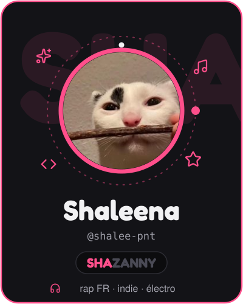
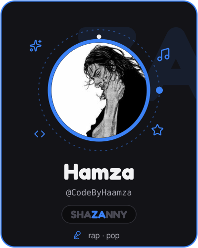
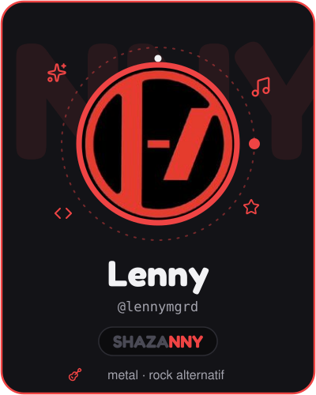
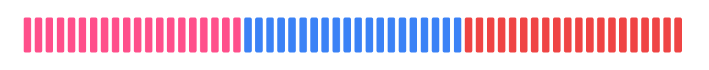

<b>SHA</b>leena · ham<b>ZA</b> · le<b>NNY</b> : un nom, trois morceaux, comme le S du logo.

## 👋 L'équipe

<table>
  <tr>
    <td align="center" width="33%"></td>
    <td align="center" width="33%"></td>
    <td align="center" width="33%"></td>
  </tr>
</table>

## 🚀 Nos projets

**🎧 Qui écoute ça ?** · 🔒 dépôt privé 
Le blind test entre potes : un extrait passe, et on devine **dans la playlist de qui** il se trouve.
Mode paroles, annonces arcade, titres de fin de partie (dont « Goûts de chiotte »), joué en vrai sur le
même wifi. Next.js, React, TypeScript, extraits Deezer.

## 🧰 Ce qu'on utilise

## 🤝 Comment on bosse

<table>
  <tr>
    <td align="center" width="25%"><h3>🌿</h3>Une idée, une branche, une pull request</td>
    <td align="center" width="25%"><h3>👀</h3>On se relit à trois avant de fusionner</td>
    <td align="center" width="25%"><h3>💬</h3>Code commenté et commits en français</td>
    <td align="center" width="25%"><h3>🎮</h3>On teste en jouant, entre nous</td>
  </tr>
</table>

Images animées générées par <a href="assets/generer.py"><code>assets/generer.py</code></a> · logo dans <a href="assets/logo/"><code>assets/logo/</code></a> · crédits dans <a href="assets/CREDITS.md"><code>CREDITS.md</code></a>

